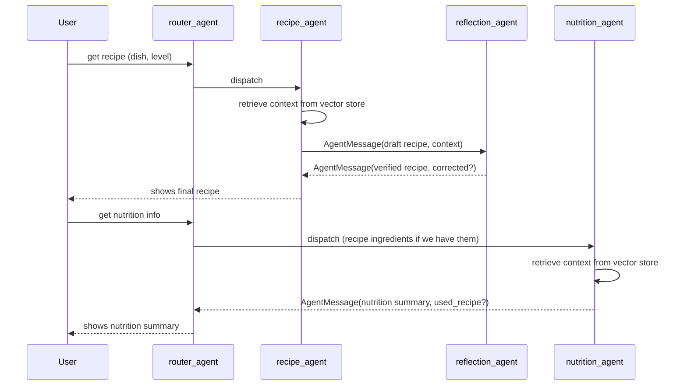

# 🍛 Sri Lankan Flavor Assistant

This is my project for IT41043 (Intelligent Systems - Agentic AI) at Horizon Campus. It's a Streamlit app that gives you a Sri Lankan recipe based on how spicy or sweet you want it, and can also work out a rough nutrition breakdown for it. Instead of just letting an LLM make things up, I built it around a small multi-agent setup with RAG so the answers are actually grounded in real recipe data.

Live demo: https://sl-flavor-agent-bydil.streamlit.app/
Repo: https://github.com/dilekha2001/sl-flavor-agent

## What it does

You pick a dish (either the one featured that day or from the full list), move the spice/sweetness slider, then click either:

- **Get Recipe** - generates a recipe at your chosen level, then a second agent checks it against the source material before you see it
- **Get Nutrition Info** - gives calories/protein/fat/carbs/sodium. If you already got a recipe for that dish, it uses the actual ingredients from that recipe instead of guessing generically

## Agentic design patterns

I used three patterns here, not just one dressed up as three:

**Router** - `router_agent()` looks at whether the request is for a recipe or nutrition info and sends it to the right place. Pretty simple but it's the thing that decides everything else.

**Tool-use (RAG)** - both `recipe_agent` and `nutrition_agent` call `vectorstore.similarity_search()` before they generate anything. This is what stops the model from just hallucinating a recipe out of nowhere - it has to work from what's actually in the corpus.

**Reflection** - after `recipe_agent` writes a first draft, it gets sent over to `reflection_agent`, which checks it against the same context and either leaves it alone or fixes anything that doesn't match up with the source material (and adds a note saying it corrected something).

## How the agents talk to each other

I didn't use LangGraph or CrewAI for this - just a small custom class called `AgentMessage` (sender, recipient, payload, timestamp) that agents pass between each other instead of just returning plain strings. Honestly this was mostly so I could actually see and trace what was being handed off where, and it made the reflection/nutrition parts feel less like one big function and more like separate things talking to each other.



Two real exchanges happen: `recipe_agent` <-> `reflection_agent` for the verification step, and `recipe_agent` -> `nutrition_agent` -> back for the nutrition step (it replies with a flag saying whether it actually used the recipe's exact ingredients or just fell back to generic corpus data).

## Model choice

I used two different models for two different jobs rather than just picking one and using it everywhere:

| Sub-task | Model | Provider | Latency | Cost/token | Context window | Reasoning quality |
|---|---|---|---|---|---|---|
| Recipe writing + reflection | Llama-3.1-8B-instruct | OpenRouter | slower (~1-2s) | low but not free | 128K | good enough for writing + critiquing its own output |
| Nutrition extraction | Llama-3.1-8B-instant | Groq | fast (~150-300ms) | basically free | 128K | fine - it's just pulling numbers from context, not writing anything creative |

The reasoning was basically: recipe generation + checking itself is the harder job, so it's worth paying a bit more latency/cost for better instruction following. Nutrition is a much simpler lookup-style task so I didn't see the point in using the slower/pricier model there - Groq is fast enough and free enough that it made no sense not to use it.

## RAG setup

- 22 dish text files (20 mains, 2 desserts) as the corpus
- Split each one using `RecursiveCharacterTextSplitter` with `chunk_size=500` and `chunk_overlap=50` - mostly breaks on paragraph gaps first, then sentences. Ends up being roughly 3-8 chunks per dish, somewhere between 130-500 characters each
- Embeddings: `sentence-transformers/all-MiniLM-L6-v2`
- Stored in a local Chroma instance (`./chroma_db`), loaded once with `@st.cache_resource` so it's not rebuilt on every Streamlit rerun
- Recipe generation pulls top-3 chunks, nutrition pulls top-2

### Did retrieval actually work?

I ran 5 test queries directly against the store to check:

| Query | What came back | Relevant? |
|---|---|---|
| spicy chicken curry | chicken_curry.txt | yes |
| vegetarian dish | fish_curry.txt, kottu_roti.txt | no |
| coconut sambol | pol_sambol.txt, milk_rice.txt | kind of |
| dessert | watalappan.txt, curd_and_treacle.txt | yes |
| mild curry | potato_curry.txt, pumpkin_curry.txt | yes |

3 out of 5 solid. The vegetarian one failed because none of my files are actually tagged by diet - it's just matching on curry-related text similarity, so it pulls back chicken/fish dishes anyway. If I had more time I'd add a diet field to the metadata and filter on that alongside the similarity search.

## Setup

```bash
git clone https://github.com/dilekha2001/sl-flavor-agent.git
cd sl-flavor-agent
python -m venv venv
venv\Scripts\activate
pip install -r requirements.txt
```

Add a `.env` file:
```
GROQ_API_KEY=your_key
OPENROUTER_API_KEY=your_key
```

Run it:
```bash
streamlit run app.py
```

`chroma_db` is already built and included in the repo. If you need to rebuild it (e.g. you changed the files in `./data`), there's a `rebuild_chroma.py` script that does it from scratch with the chunking settings above.

## Limitations

- Only 22 dishes - anything outside that just gets whatever's closest, not necessarily right
- No memory across separate requests - each click is basically independent except for the one recipe -> nutrition handoff
- Reflection catches obvious stuff but it's not perfect - nutrition numbers especially are still just estimates
- If Groq or OpenRouter goes down, that part of the app just breaks - no backup provider
- Retrieval doesn't really understand dietary constraints since there's no metadata for that (see above)
- No rate limiting on the demo so don't hammer it too hard
- English only right now
